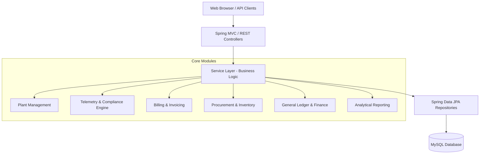

# Smart Waste Water Management System 🌊

[](https://www.oracle.com/java/)
[](https://spring.io/projects/spring-boot)
[](https://www.mysql.com/)
[](https://www.thymeleaf.org/)
[](LICENSE)

An enterprise-grade, IoT-ready Smart Waste Water Management and Industrial Utility ERP application built using **Spring Boot**, **Spring Data JPA**, **Thymeleaf**, and **MySQL**. 

This platform enables wastewater treatment authorities, municipal corporations, and industrial park managers to monitor treatment plants in real time, track factory effluent telemetry, automate compliance verification, manage utility billing, control chemical procurement, and maintain complete double-entry financial accounting.

---

## 📋 Table of Contents

- [Key Features](#-key-features)
- [System Architecture](#-system-architecture)
- [Technology Stack](#-technology-stack)
- [Project Structure](#-project-structure)
- [Prerequisites](#-prerequisites)
- [Getting Started](#-getting-started)
- [Configuration](#-configuration)
- [REST API Endpoints](#-rest-api-endpoints)
- [Web UI Dashboard](#-web-ui-dashboard)
- [Contributing](#-contributing)
- [License](#-license)

---

## 🚀 Key Features

### 1. 🏭 Treatment Plant & Facility Management
- Register and manage wastewater treatment plants (STPs / ETPs / CETPs).
- Track design capacity, processing limits, and live operational status (Active, Maintenance, Offline).
- Maintain allowed thresholds for Chemical Oxygen Demand (COD), Biochemical Oxygen Demand (BOD), Total Suspended Solids (TSS), and pH levels.

### 2. 🧪 Real-Time Effluent Telemetry & Compliance
- Ingest real-time sensor data from connected factory outlets and plant discharge points.
- Automatically monitor critical parameters:
  - **pH levels** (Acidity / Alkalinity)
  - **COD & BOD** (Organic load)
  - **TSS** (Total Suspended Solids)
  - **Flow Rate & Discharge Volume**
- Automatic anomaly and violation detection against regulatory thresholds with compliance status tagging (`COMPLIANT`, `WARNING`, `VIOLATION`).

### 3. 🏢 Industrial Customer & Vendor Management
- Manage factories, industrial units, and chemical/equipment suppliers.
- Track contact details, discharge licenses, tax IDs, and billing terms.

### 4. 💳 Utility Billing & Invoicing
- Automated invoice calculation based on discharge volume and pollutant concentrations (surcharge penalties for elevated COD/BOD).
- Complete lifecycle management: Draft -> Validated -> Paid / Cancelled.
- Record customer payments across multiple payment channels (Bank Transfer, Credit, Cheque, Cash).

### 5. 📦 Procurement & Supply Chain
- Manage chemical supplies (Coagulants, Flocculants, Disinfectants) and maintenance equipment.
- Purchase Order (PO) workflow: Request for Quotation (RFQ) -> Purchase Order -> Delivery Receipt.
- Vendor Bill matching and automated vendor payment disbursement.

### 6. 📊 Accounting & Financial ERP
- Full double-entry general ledger with customizable Chart of Accounts (Assets, Liabilities, Equity, Revenue, Expenses).
- Automated journal entry creation for invoices, payments, vendor bills, and disbursements.
- Analytical accounting to track expenses and revenues per treatment plant or cost center.
- Real-time financial reports:
  - **Profit & Loss Statement (P&L)**
  - **Balance Sheet**
  - **Budget vs. Actual Performance Reports**
  - **Environmental Compliance Summaries**

---

## 🏛️ System Architecture



---

## 🛠️ Technology Stack

| Layer | Technology |
|---|---|
| **Backend Framework** | Spring Boot 4.x / Spring Framework 6.x |
| **Language** | Java 17 (LTS) |
| **Persistence / ORM** | Spring Data JPA / Hibernate |
| **Database** | MySQL 8.x |
| **Frontend Templates** | Thymeleaf, HTML5, CSS3, JavaScript |
| **Boilerplate Reduction** | Project Lombok |
| **Validation** | Jakarta Bean Validation (Hibernate Validator) |
| **Build Tool** | Apache Maven |

---

## 📁 Project Structure

```text
WasteWater_Management_System/
├── src/
│   ├── main/
│   │   ├── java/com/example/WasteWater_Management_System/
│   │   │   ├── config/             # Application & Web configurations
│   │   │   ├── controller/         # REST Controllers & MVC View Controllers
│   │   │   ├── dto/                # Data Transfer Objects & Report projections
│   │   │   ├── exception/          # Global exception handler & custom exceptions
│   │   │   ├── models/             # JPA Entities (Plants, Telemetry, Invoices, Accounts, etc.)
│   │   │   │   └── enums/          # Status and Type Enums
│   │   │   ├── repository/         # Spring Data JPA Repository interfaces
│   │   │   └── services/           # Business logic & transaction handling
│   │   └── resources/
│   │       ├── static/             # Static web assets (CSS, JS, images)
│   │       ├── templates/          # Thymeleaf UI templates
│   │       │   ├── fragments/      # Reusable layout fragments (navbar, sidebar)
│   │       │   ├── dashboard.html
│   │       │   ├── plants.html
│   │       │   ├── telemetry.html
│   │       │   ├── invoices.html
│   │       │   ├── factories.html
│   │       │   ├── procurement.html
│   │       │   ├── utility-billing.html
│   │       │   └── reports-*.html
│   │       └── application.properties # Configuration parameters
│   └── test/                       # Unit and integration test suites
├── pom.xml                         # Maven dependencies & build plugins
└── README.md                       # Project documentation
```

---

## ⚙️ Prerequisites

Ensure you have the following installed on your local environment:
- **Java Development Kit (JDK) 17** or higher
- **MySQL Server 8.0+**
- **Git**
- *(Optional)* Maven 3.8+ (The project includes the Maven Wrapper `./mvnw`)

---

## 🚀 Getting Started

### 1. Clone the Repository
```bash
git clone https://github.com/sethukamalpg/Smart-Waste-Water-Management-System.git
cd Smart-Waste-Water-Management-System
```

### 2. Configure the Database
Create a MySQL database for the system:
```sql
CREATE DATABASE wastewaterdb;
```

Update your database credentials in `src/main/resources/application.properties`:
```properties
spring.datasource.url=jdbc:mysql://localhost:3306/wastewaterdb?createDatabaseIfNotExist=true&useSSL=false&serverTimezone=UTC
spring.datasource.username=root
spring.datasource.password=YOUR_MYSQL_PASSWORD
spring.datasource.driver-class-name=com.mysql.cj.jdbc.Driver

# Hibernate auto table generation
spring.jpa.hibernate.ddl-auto=update
spring.jpa.show-sql=true
```

### 3. Build the Application
```bash
# On Windows
mvnw.cmd clean package -DskipTests

# On Linux/macOS
./mvnw clean package -DskipTests
```

### 4. Run the Application
```bash
# On Windows
mvnw.cmd spring-boot:run

# On Linux/macOS
./mvnw spring-boot:run
```

The application will start on port `8080` by default.

---

## 🌐 Web UI Dashboard

Open your browser and navigate to:
```
http://localhost:8080/
```

### Available Pages:
- **`/dashboard`** - Executive overview: live stats, telemetry trends, revenue vs. expense cards.
- **`/plants`** - Treatment plant operational status, capacity, and emission controls.
- **`/telemetry`** - Live effluent monitoring, discharge logs, and violation alerts.
- **`/factories`** - Connected industrial customer directory and discharge agreements.
- **`/utility-billing`** & **`/invoices`** - Volume-based billing and invoice collection.
- **`/procurement`** - Chemical inventory orders and vendor bills.
- **`/budget`** - Analytical cost centers and department budget tracking.
- **`/reports/compliance`** - Environmental regulatory compliance metrics.
- **`/reports/profit-loss`** - Comprehensive P&L and Balance Sheet reports.

---

## 🔌 REST API Endpoints

The system exposes full RESTful endpoints for headless integration with IoT gateways and external ERP systems:

| Module | Method | Endpoint | Description |
|---|---|---|---|
| **Plants** | `GET` / `POST` | `/api/plants` | List or register treatment plants |
| **Plants** | `GET` / `DELETE` | `/api/plants/{id}` | Plant details / decommissioning |
| **Telemetry** | `POST` | `/api/telemetry` | Record IoT sensor effluent reading |
| **Telemetry** | `GET` | `/api/telemetry/plant/{plantId}` | Fetch telemetry readings by plant |
| **Invoices** | `GET` / `POST` | `/api/invoices` | List or generate customer invoices |
| **Invoices** | `PUT` | `/api/invoices/{id}/pay` | Settle customer invoice payment |
| **Procurement** | `GET` / `POST` | `/api/purchase-orders` | Manage POs and chemical supplies |
| **Vendor Bills** | `GET` / `POST` | `/api/vendor-bills` | Track vendor accounts payable |
| **Accounting** | `GET` | `/api/accounts` | Chart of accounts list |
| **Reports** | `GET` | `/api/reports/compliance` | Get compliance & violation metrics |
| **Reports** | `GET` | `/api/reports/profit-loss` | Financial P&L summary |

---

## 🧪 Testing

To run unit and service integration tests:
```bash
# On Windows
mvnw.cmd test

# On Linux/macOS
./mvnw test
```

---

## 🤝 Contributing

Contributions, issues, and feature requests are welcome!
1. Fork the Project.
2. Create your Feature Branch (`git checkout -b feature/AmazingFeature`).
3. Commit your Changes (`git commit -m 'Add some AmazingFeature'`).
4. Push to the Branch (`git push origin feature/AmazingFeature`).
5. Open a Pull Request.

---

## 📄 License

This project is licensed under the MIT License. See the [LICENSE](LICENSE) file for details.
